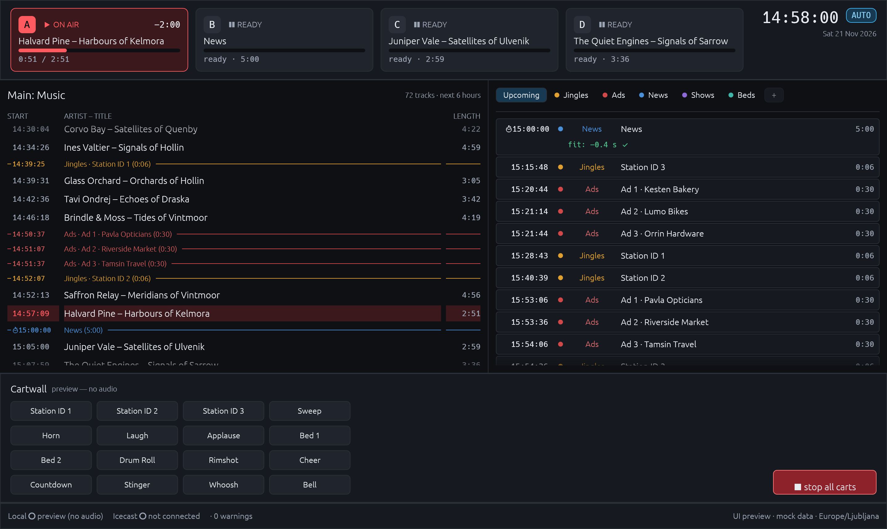
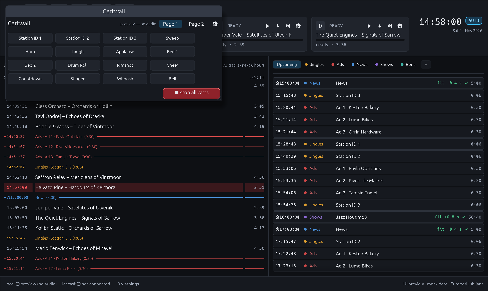
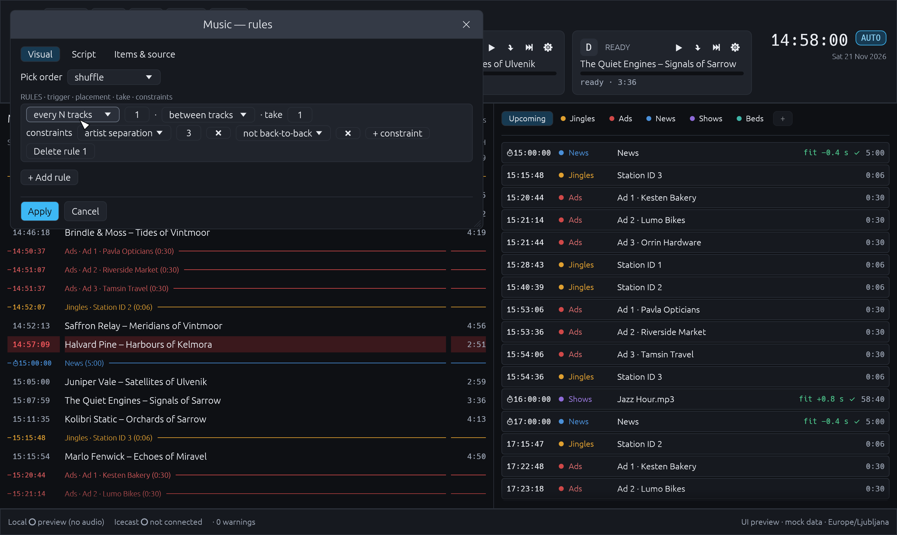

<p align="center">
  
</p>

<h1 align="center">CraftRadio</h1>

<p align="center">
  <b>Radio station automation and playout, in pure Rust.</b><br>
  Four decks driven by a playlist that shows when every item starts, fixed-time events that land on time,<br>
  a cartwall, JavaScript rules, and output to the sound card and Icecast.
</p>

<p align="center">
  
  
  
  
</p>

<p align="center">
  <a href="#get-started"><b>Build CraftRadio</b></a> ·
  <a href="#downloads">Downloads</a> ·
  <a href="https://github.com/RadioTerminal/craftradio/issues">Issues</a>
</p>

<br>

<p align="center">
  
  <br>
  <sub>The main window in the UI preview (<code>--demo</code>, mock data): four decks, the main playlist with a start time for every item, and what the other playlists weave in next.</sub>
</p>

<p align="center">
  <a href="#how-it-works">How it works</a> ·
  <a href="#built-for-scripts-and-agents">Scripts and agents</a> ·
  <a href="#under-the-hood">Under the hood</a> ·
  <a href="#get-started">Get started</a> ·
  <a href="#status">Status</a> ·
  <a href="#downloads">Downloads</a>
</p>

<br>

<table>
  <tr>
    <td width="25%" valign="top">
      <h3>🎚️ Four decks</h3>
      Decks A–D with crossfades, cue points and pre-loading, so the next item is always ready. Loudness is levelled per track (EBU R128).
    </td>
    <td width="25%" valign="top">
      <h3>🕒 On time</h3>
      Every item shows when it starts. Pin news or an ad break to the second and the playlist rearranges itself so it lands on time.
    </td>
    <td width="25%" valign="top">
      <h3>📻 On air</h3>
      Music, jingles, ads and internet streams, played to the sound card and to Icecast (MP3 or Opus, with TLS).
    </td>
    <td width="25%" valign="top">
      <h3>🧩 Scriptable</h3>
      Every action is an engine command, so the CLI does what the app does. Playlist rules are JavaScript.
    </td>
  </tr>
</table>

<br>

## How it works

A station has one **main playlist** and any number of **named playlists** (jingles, ads, news,
shows, beds). Each named playlist has **rules**, written as a JavaScript script, that weave its
items into the main one: a jingle every 15 minutes, the ad break at :20, never two ads in a row.

1. **Plan:** the scheduler merges every playlist into one timeline and gives each item its start
   time, with fixed-time events fitted inside their tolerance.
2. **Play:** the decks load the next items ahead of time and play them on cue; the mixer sends
   Program to the sound card and to Icecast.
3. **Watch:** the clock, history and alarms windows show what aired, what was late and what
   needs a person.

<table>
  <tr>
    <td width="50%" valign="top">
      <br>
      <sub><b>Cartwall:</b> jingles and effects over whatever is on air.</sub>
    </td>
    <td width="50%" valign="top">
      <br>
      <sub><b>Rules:</b> how a playlist is woven into the main one.</sub>
    </td>
  </tr>
</table>

## Built for scripts and agents

Every user-visible action is a command in the engine, and the app, the CLI and scripts dispatch
it by id. So a station can be run and changed without the window:

```sh
craftradio --headless --data-dir ./station            # run a station without a window
craftradio-cli commands                               # every engine command, with its tier
craftradio-cli cmd --data-dir ./station '{"id":"playlist.create","args":{"name":"Night"}}'
craftradio-cli plan examples/station.toml --hours 4   # the timeline a station file produces
```

An MCP server is planned on the same commands (`docs/superpowers/plans/2026-11-21-roadmap.md`).

## Going off air

One switch takes the station off air. Off air stops the Icecast push and WebRTC, even when
the app started with `--webrtc`. The decks, the cartwall, the events and the sound card go on
playing, so the studio keeps working while nothing leaves the computer. Back on air, Icecast
reconnects with the settings the app started with, and WebRTC follows its own setting. A
station saved off air starts off air and connects nothing.

In the window there is an On air button above the output strips and an On Air item in the
Playout menu, with the shortcut shown in the Playout menu. Switching takes two presses within
a few seconds, both ways, like cutting the item on air; the deck preference that turns off
cut confirmation does not apply. While Icecast reconnects after going on air, the button
reads "Going on air…". The headless app prints `radio: on air` or `radio: off air` at start
and on every change.

The setting is part `air`, key `on_air` (a JSON boolean; absent means on air). A script, the
MCP server or the control channel switches it at once, with no second press:

```sh
craftradio-cli cmd --data-dir ./station '{"id":"settings.set","args":{"part":"air","key":"on_air","value":false}}'
```

That line edits the station file, so close the app first (a running app keeps its own copy).
For a running station use the `settings_set` MCP tool or `station.run` on the control channel
([docs/control.md](docs/control.md)) with the same `id` and `args`.

## Under the hood

A Rust workspace in layers: plain data (`model`), DST-safe time (`timing`), scheduling and the
media library, audio (decks, mixer, outputs) and the JavaScript runtime, the engine with its
command registry and as-played log, and the egui desktop UI on top. Audio is decoded with
Symphonia, levelled with EBU R128, and encoded with Opus or craft-audio's native MP3 encoder for Icecast. The spec is
[docs/2026-11-21-radio-station-manager-design.md](docs/2026-11-21-radio-station-manager-design.md)
and the rules for changing the code are in [AGENTS.md](AGENTS.md).

## Get started

Requires Rust **1.97 or newer** and CMake (for Opus):

```sh
brew install cmake                                    # macOS
sudo apt-get install libasound2-dev cmake pkg-config  # Debian/Ubuntu
```

Then:

```sh
git clone https://github.com/RadioTerminal/craftradio && cd craftradio
cargo run --release -p radio                          # the desktop app (craftradio)
cargo run --release -p radio -- --demo                # the UI with mock data, no audio
cargo install --path apps/radio-cli                   # the CLI, as `craftradio-cli`
```

## Status

> [!IMPORTANT]
> **CraftRadio is in prerelease.** The [downloads](#downloads) for Windows and macOS are test
> builds: not signed yet, and not for a station on air.
>
> - **Works today:** the desktop app, headless mode and the CLI; four decks with R128 loudness;
>   the scheduler with fixed-time events and JavaScript rules; the library, cartwall, clock,
>   history and alarms windows; internet streams and Icecast output with TLS.
> - **Partly there:** live sound-card input and PFL to a cue device.
> - **Not there yet:** the MCP server, the reliability milestone (silence detector, fallback
>   playlist, webhook alarms, 24 h soaks), and a first signed release.
>
> The milestones are in [docs/superpowers/plans/2026-11-21-roadmap.md](docs/superpowers/plans/2026-11-21-roadmap.md).
> Please file issues.

## Downloads

The newest build is the prerelease
**[v0.1.1](https://github.com/RadioTerminal/craftradio/releases/tag/v0.1.1)**; every build is on the
[releases page](https://github.com/RadioTerminal/craftradio/releases). Each release has a
`SHA256SUMS.txt` with a checksum for every file. How a release is made:
[docs/releasing.md](docs/releasing.md).

> [!NOTE]
> The builds are not signed yet. Windows SmartScreen asks before the first start: choose
> **More info**, then **Run anyway**. On macOS, copy CraftRadio to Applications, then
> Control-click it and choose **Open**, or run
> `xattr -dr com.apple.quarantine /Applications/CraftRadio.app` once.

### Windows

| Build | Installer | Portable |
|---|---|---|
| x64 (64-bit Intel/AMD) | [`craftradio-0.1.1-windows-x64.msi`](https://github.com/RadioTerminal/craftradio/releases/download/v0.1.1/craftradio-0.1.1-windows-x64.msi) | [`craftradio-0.1.1-windows-x64-portable.zip`](https://github.com/RadioTerminal/craftradio/releases/download/v0.1.1/craftradio-0.1.1-windows-x64-portable.zip) |
| arm64 (Snapdragon and other ARM PCs) | [`craftradio-0.1.1-windows-arm64.msi`](https://github.com/RadioTerminal/craftradio/releases/download/v0.1.1/craftradio-0.1.1-windows-arm64.msi) | [`craftradio-0.1.1-windows-arm64-portable.zip`](https://github.com/RadioTerminal/craftradio/releases/download/v0.1.1/craftradio-0.1.1-windows-arm64-portable.zip) |

### macOS

| Build | File |
|---|---|
| App, universal (Apple silicon + Intel) | [`craftradio-0.1.1-macos-universal.dmg`](https://github.com/RadioTerminal/craftradio/releases/download/v0.1.1/craftradio-0.1.1-macos-universal.dmg) |
| Command-line tool, universal | [`craftradio-cli-0.1.1-macos-universal.zip`](https://github.com/RadioTerminal/craftradio/releases/download/v0.1.1/craftradio-cli-0.1.1-macos-universal.zip) |

### Linux

Not in releases yet: build from source (see [Get started](#get-started)). When releases
include Linux, they will have:

| Format | x86_64 | aarch64 (ARM64) | Notes |
|---|---|---|---|
| AppImage | `craftradio-<ver>-linux-x86_64.AppImage` | `craftradio-<ver>-linux-aarch64.AppImage` | Runs anywhere; updates itself with [AppImageUpdate](https://github.com/AppImageCommunity/AppImageUpdate) (`.zsync` files) |
| Debian/Ubuntu | `craftradio-<ver>-linux-x86_64.deb` | `craftradio-<ver>-linux-aarch64.deb` | |
| Fedora/RHEL/openSUSE | `craftradio-<ver>-linux-x86_64.rpm` | `craftradio-<ver>-linux-aarch64.rpm` | |
| Tarball | `craftradio-<ver>-linux-x86_64.tar.gz` | `craftradio-<ver>-linux-aarch64.tar.gz` | Unpack anywhere |

## License and credits

CraftRadio is dual-licensed under [MIT](LICENSE-MIT) or [Apache-2.0](LICENSE-APACHE), at your
option. MP3 encoding uses the native encoder of
[craft-audio](https://github.com/storytold/craft-libs) (MIT OR Apache-2.0).

The layout of the Preferences window follows
[SolidCraft](https://github.com/tangency-labs/solidcraft)'s, whose interface design is under the
SolidCraft Brand and Interface Licence. It is adapted here with the SolidCraft maintainers'
permission. No SolidCraft code, icons or theme tokens are included.

The screenshots show invented stations, artists and titles.
